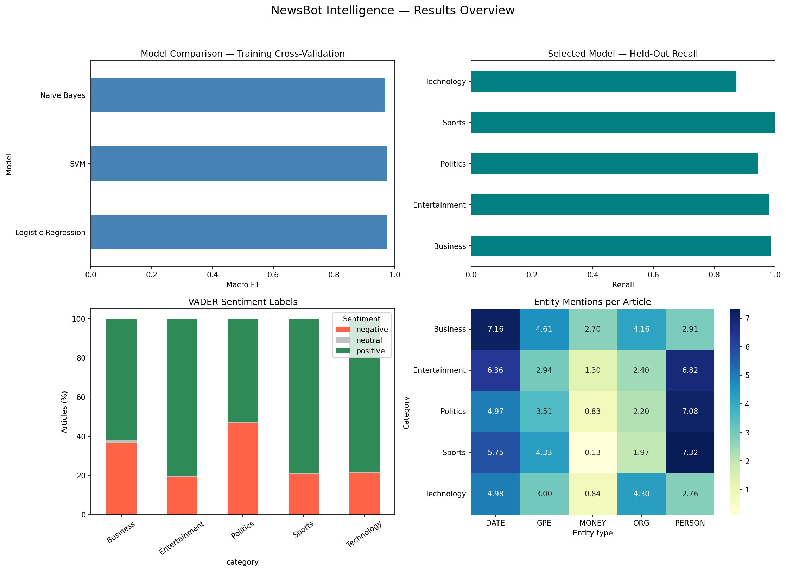

# NewsBot Intelligence System

**ITAI 2373 Midterm · TeamLeemannTaylor**  
**Kate Leemann and Roderick Taylor**

[Portfolio repository](https://github.com/SCheeses/Kate-Leemann-AI-Portfolio) · [Working Colab notebook](https://colab.research.google.com/drive/1JVHzPeUvwiLKFz6JIM13lt9KGdJ2PEm0)

## Purpose

A prototype for news editors and media-monitoring analysts: categorize articles, extract people and organizations, inspect textual sentiment, and explore linguistic patterns. Predictions support human review. Operational time savings and production readiness have not been established.

## Run in Google Colab

1. Open `NewsBot_Intelligence_System.ipynb` in free Google Colab and save your own copy.
2. Sign in to Kaggle and accept the applicable competition rules for the [BBC News Classification dataset](https://www.kaggle.com/competitions/learn-ai-bbc/data).
3. Download and extract `BBC News Train.csv`. Upload it to Colab session storage so its path is `/content/BBC News Train.csv`.
4. Run the notebook from the beginning. The setup cell installs dependencies and downloads the small spaCy model and NLTK resources. A CPU runtime is sufficient.
5. Inspect outputs as the cells finish. The last code cell downloads `newsbot_outputs.zip`. Session files are temporary, so save your results before ending the runtime.

No Kaggle API key is needed for this manual-download workflow. The dataset is not distributed in this repository. Individual users must obtain it from Kaggle under its applicable terms.

## Dataset and evaluation

The instructor-approved dataset contains 1,490 labeled articles. Removing 50 exact duplicate texts leaves 1,440 articles in Business, Entertainment, Politics, Sports, and Technology. Health is not represented. A stratified split reserves 288 articles for testing and 1,152 for training. Vocabulary fitting occurs within each training fold during three-fold cross-validation. Four TF-IDF configurations are compared for each algorithm.

| Algorithm | Best CV macro F1 |
|---|---:|
| Logistic Regression | 0.9749 |
| Linear SVM | 0.9746 |
| Multinomial Naive Bayes | 0.9685 |

Logistic Regression was selected using cross-validation. Held-out accuracy was **96.18% (277/288)** and macro F1 was **0.9598**. Technology had the lowest recall, **87.23%**. Gaming and technology-company coverage sometimes overlapped with Sports and Business. The small CV difference between Logistic Regression and SVM does not establish statistical superiority.

## Module coverage

| Module | Implementation |
|---|---|
| 1: Application context | Editorial routing and media-monitoring use case |
| 2: Preprocessing | Cleaning, tokenization, stop words, basic lemmatization |
| 3: TF-IDF | Vocabulary restriction, parameter comparison, term plots, classifier coefficients |
| 4: POS | Article-level proportions and cross-category heatmap |
| 5: Syntax | Dependency features, sentence diagram, simple active-voice relationship extraction |
| 6: Sentiment/emotion | VADER plus an explicitly exploratory emotion-keyword baseline |
| 7: Classification | Three algorithms, training-only tuning, held-out report and confusion matrix |
| 8: NER | PERSON, ORG, GPE, DATE, MONEY; frequency and co-occurrence analysis |

The integrated class applies classification, sentiment, entities, emotion cues, POS, dependency relationships, and TF-IDF analysis to new inputs. Two fictional examples demonstrate functionality; they are not a real-news evaluation.

## Selected findings

- Technology had the highest median article length: 461.5 words.
- Business had the highest number-token proportion (3.89%) and MONEY mentions per article (2.70).
- Politics had the highest verb proportion (13.68%) and mean sentence length (22.45 tokens).
- VADER labeled 80.23% of Entertainment articles positive; Politics had the largest negative-label share (46.62%).
- Sports had the most PERSON mentions per article (7.32); Technology had the most ORG mentions (4.30).
- Entity aliases remain unresolved: Tony Blair and Blair co-occurred in 51 articles.

## Limitations

This historical, single-publisher split does not establish performance on current news. Near-duplicate stories may remain. Lowercase source text reduces useful tagging clues. Basic preprocessing merges hyphenated words and does not fully handle contractions or HTML entities. Emotion cues use a small hand-selected, AI-assisted lexicon, not a validated emotion classifier. VADER, NER, and relationship extraction lack human-labeled accuracy evaluation. Co-occurrence is not evidence of an actual relationship. Model probabilities are not guarantees; unsupported categories still receive a known label. Human review is necessary.

## Files

- `NewsBot_Intelligence_System.ipynb`: executed notebook, explanations, and demonstration.
- `outputs/`: charts, statistical tables, entity mentions, and fictional demo results.
- Required team reflection: to be added after team review.

The locally generated `test_predictions.csv` and `subject_verb_object_relationships.csv` contain full articles or sentence excerpts and are omitted from this public file set. Notebook outputs retain limited illustrative excerpts. The raw and processed datasets are also excluded.

## Contributions and assistance

Kate Leemann and Roderick Taylor report equal, side-by-side collaboration with shared responsibilities rather than independently owned modules. Kate's individual contribution is participation in this shared development, execution, review, and documentation workflow; Roderick is credited as an equal collaborator. Each member should review the final materials before submission.

The project adapts the instructor's starter notebook. OpenAI ChatGPT/Codex provided substantial code adaptation, debugging, explanations, and documentation assistance. 

## References

- Instructor-provided ITAI 2373 NewsBot starter notebook and assignment instructions.
- [BBC News Classification on Kaggle](https://www.kaggle.com/competitions/learn-ai-bbc/data)
- [scikit-learn](https://scikit-learn.org/stable/)
- [spaCy](https://spacy.io/usage)
- [NLTK](https://www.nltk.org/)
- [VADER](https://github.com/cjhutto/vaderSentiment)

The optional video is not included.
